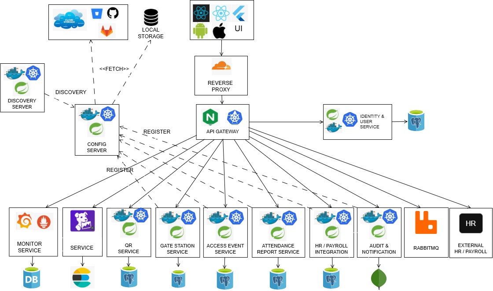

# BTL Kiến trúc phần mềm học kỳ 261

## Thành viên nhóm

| STT | MSSV | Họ và tên |
|---|---|---|
| 1 | 2313336 | Trương Hoàng Thông |
| 2 | 2311557 | Nguyễn Quốc Khải |
| 3 | 2311572 | Đặng Ngọc Khiêu |
| 4 | 2310545 | Huỳnh A Dũng |
| 5 | 2310210 | Đặng Gia Bảo |

Mục đích:
- Mô tả tổng quan kiến trúc microservice, cách chạy, cấu hình chính và tài liệu API của workspace.
- Áp dụng SOLID, OOP design pattern, software design & architechture
## Tổng quan kiến trúc
- Kiến trúc: Microservices (Tech-stack Diagram)
- Sẵn sàng để chuyển đổi triển khai CI-CD.

## Software Diagram - Software Document

### UI - FIGMA
[Link Liên kết design figma](https://www.figma.com/design/d1qxFxSrscX8m4b7nsrOCL/TMC-Access-Attendance-UI?node-id=92-0&t=MT4qUGmSLTR0GQ6B-1)

## TMC-AACS Backend

Backend cho hệ thống kiểm soát ra/vào bằng QR và chấm công của TMC, tổ chức thành **7 service nghiệp vụ** và **3 ứng dụng hạ tầng Spring**.

## Công nghệ

| Thành phần | Cấu hình trong repository |
|---|---|
| Java | 21 |
| Build | Maven; mỗi ứng dụng có `pom.xml` và Maven Wrapper riêng |
| Spring Boot | `4.2.0` |
| Spring Cloud | `2026.0.0-SNAPSHOT` |
| API | Spring MVC; Gateway dùng Spring Cloud Gateway Server Web MVC |
| Discovery | Eureka |
| Cấu hình | Spring Cloud Config Server, profile `native` |
| Sự kiện | RabbitMQ |
| Database | PostgreSQL cho 6 service; MongoDB cho Audit & Notification |
| Email local | SMTP mặc định tại `localhost:1025` |

Phiên bản được quản lý trong từng POM. Bộ khung hiện giữ các ứng dụng Maven độc lập, không có POM cha tại thư mục `backend`.

Toàn bộ 10 ứng dụng nằm trong `services/`; mỗi thư mục có `pom.xml`, Maven Wrapper và `.env.example` riêng.

Thư viện dùng chung nằm tại `libraries/api-support` và `libraries/event-support`. Trước lần build đầu, chạy `mvn -f .\libraries\api-support\pom.xml install`, tiếp theo `mvn -f .\libraries\event-support\pom.xml install`, rồi build từng ứng dụng bằng POM riêng.

## Sơ đồ kiến trúc



## Trách nhiệm các service

Bảng dưới mô tả kiến trúc đầy đủ. Phạm vi MVP gồm Identity & User, QR, Gate Station, Access & Attendance Event và 3 service hạ tầng; Attendance Report, HR/Payroll Integration, Audit & Notification thuộc giai đoạn sau.

| Service nghiệp vụ | Trách nhiệm | Kho dữ liệu |
|---|---|---|
| Identity & User Service | Quản lý nhân viên, tài khoản, đăng nhập và phân quyền RBAC | PostgreSQL |
| QR Service | Sinh QR động có chữ ký, thời hạn sử dụng và xác thực QR | PostgreSQL |
| Gate Station Service | Quản lý cổng, kiosk, scanner; tích hợp API điều khiển turnstile | PostgreSQL |
| Access & Attendance Event Service | Ghi nhận sự kiện vào/ra theo kiểu append-only, chống ghi trùng | PostgreSQL |
| Attendance Report Service | Tổng hợp công và báo cáo cho HR, giám sát, ban lãnh đạo | PostgreSQL |
| HR/Payroll Integration Service | Xuất dữ liệu, retry và đối soát với hệ thống HR/Payroll bên ngoài | PostgreSQL |
| Audit & Notification Service | Lưu audit log và gửi thông báo từ sự kiện nghiệp vụ | MongoDB |

| Service hạ tầng | Trách nhiệm |
|---|---|
| API Gateway | Định tuyến yêu cầu từ client đến các service |
| Discovery Server (Eureka) | Đăng ký và tra cứu địa chỉ các instance |
| Config Server | Cung cấp cấu hình tập trung cho các service |

## API & kiểm thử

Import Postman collections:

- [identity-user-service.postman_collection.json](docs/postman/identity-user-service.postman_collection.json)
- [qr-service.postman_collection.json](docs/postman/qr-service.postman_collection.json)
- [gate-station-service.postman_collection.json](docs/postman/gate-station-service.postman_collection.json)
- [access-event-service.postman_collection.json](docs/postman/access-event-service.postman_collection.json)
- [api-gateway.postman_collection.json](docs/postman/api-gateway.postman_collection.json)
- [config-server.postman_collection.json](docs/postman/config-server.postman_collection.json)
- [discovery-server.postman_collection.json](docs/postman/discovery-server.postman_collection.json)

Điền biến URL, token và ID theo [hướng dẫn Postman](docs/postman/README.md) trước khi gửi request.

## Danh sách ứng dụng

| Ứng dụng | Port local | Database |
|---|---:|---|
| `config-server` | 8888 | Kho cấu hình YAML |
| `discovery-server` | 8761 | Registry Eureka |
| `api-gateway` | 8080 | — |
| `identity-user-service` | 8081 | PostgreSQL: `identity_user_db` |
| `qr-service` | 8082 | PostgreSQL: `qr_db` |
| `gate-station-service` | 8083 | PostgreSQL: `gate_station_db` |
| `access-event-service` | 8084 | PostgreSQL: `access_event_db` |
| `attendance-report-service` | 8085 | PostgreSQL: `attendance_report_db` |
| `hr-integration-service` | 8086 | PostgreSQL: `hr_integration_db` |
| `audit-notification-service` | 8087 | MongoDB: `audit_notification_db` |

## Cấu trúc

```text
backend/
├── README.md
├── docs/
│   ├── api/
│   │   ├── access-api.md
│   │   ├── api-response.md
│   │   ├── attendance-hr-api.md
│   │   ├── events-audit.md
│   │   ├── identity-api.md
│   │   └── qr-gate-api.md
│   ├── architecture/
│   │   ├── architecture.md
│   │   ├── configuration.md
│   │   ├── implementation-plan.md
│   │   ├── local-setup.md
│   │   ├── requirements.md
│   │   └── solid-reflection.md
│   ├── image/
│   │   └── Diagram_DEPLOYMENT.drawio.png
│   └── postman/
│       ├── access-event-service.postman_collection.json
│       ├── api-gateway.postman_collection.json
│       ├── config-server.postman_collection.json
│       ├── discovery-server.postman_collection.json
│       ├── gate-station-service.postman_collection.json
│       ├── identity-user-service.postman_collection.json
│       ├── qr-service.postman_collection.json
│       └── README.md
├── libraries/
│   ├── api-support/
│   └── event-support/
├── services/
│   ├── access-event-service/
│   ├── api-gateway/
│   ├── config-server/
│   ├── discovery-server/
│   ├── gate-station-service/
│   ├── identity-user-service/
│   └── qr-service/
└── infra/
    ├── mongodb/
    │   ├── audit-role.js
    │   └── init-audit.js
    ├── postgres/
    │   └── init-databases.sh
    └── sql/
        └── outbox-status.sql
```

### Package Java trong mỗi service

Các service nghiệp vụ tổ chức theo layer dưới `src/main/java/com/tmc/<service>/`:

```text
├── controller/   # REST endpoint, nhận request và trả response
├── service/      # Nghiệp vụ, điều phối và transaction
├── entity/       # Model dữ liệu và enum nghiệp vụ
├── repository/   # Truy cập PostgreSQL hoặc MongoDB
├── dto/          # Request, response và hợp đồng trao đổi dữ liệu
├── config/       # Security, OAuth2, signing key và cấu hình Spring
├── client/       # Gọi API của service/hệ thống khác
├── messaging/    # Consumer, outbox publisher và giám sát sự kiện
├── exception/    # Xử lý lỗi HTTP riêng của service
└── utils/        # Hàm tiện ích thuần, ví dụ SHA-256
```

Service được controller sử dụng khai báo interface tại `service/XxxService.java`; implementation tương ứng nằm tại `service/impl/XxxServiceImpl.java`. Controller, consumer và scheduler tiếp tục inject interface. Annotation Spring và transaction đặt ở implementation; giữ tên bean hiện có. Các helper như `IdentityAccess`, `AttendanceCalculator` và worker giữ class trực tiếp khi không cần hợp đồng interface riêng.

```text
service/
├── XxxService.java          # Interface nghiệp vụ
└── impl/
    └── XxxServiceImpl.java  # Implementation
```

Chỉ tạo package khi có class sử dụng; các ứng dụng hạ tầng giữ các package cần thiết. DTO công khai nằm trong file riêng; enum gắn trực tiếp với entity có thể nằm trong entity đó. Repository SQL hiện dùng JDBC, giữ Flyway quản lý schema; thư mục `entity` không mặc định đồng nghĩa với JPA entity. Giữ package gốc của ứng dụng và ranh giới database theo service.

## Setup local

1. Chuẩn bị JDK 21, Maven hoặc Maven Wrapper, PostgreSQL, MongoDB, RabbitMQ và SMTP theo [hướng dẫn local](docs/architecture/local-setup.md).
2. Chạy Config Server trước, tiếp đến Eureka.
3. Chạy Identity & User, các service nghiệp vụ còn lại và Gateway bằng IDE hoặc Maven, mỗi ứng dụng một process.

Ví dụ từ thư mục `backend`, chạy trong các terminal riêng:

```powershell
mvn -f .\services\config-server\pom.xml spring-boot:run
```

```powershell
mvn -f .\services\discovery-server\pom.xml spring-boot:run
```

```powershell
mvn -f .\services\identity-user-service\pom.xml spring-boot:run
```

Các service lấy cấu hình qua Config Server tại `http://localhost:8888`. Địa chỉ, tài khoản và port có thể đổi bằng biến môi trường.

## File môi trường riêng

Mỗi ứng dụng có `.env` riêng ở cùng thư mục với `pom.xml`. `.env.example` chứa các giá trị giả để tham khảo và commit; `.env` được Git bỏ qua.

```text
services/qr-service/
├── .env                 # Cấu hình local của QR
├── .env.example         # Mẫu để chia sẻ
├── pom.xml
└── src/
```

Các đường dẫn import `.env` được khai báo trong `services/<service>/src/main/resources/application.yaml`.

Khi clone repository, sao chép `.env.example` thành `.env` ở từng ứng dụng rồi sửa thông tin kết nối. Spring Boot tự import file theo định dạng `KEY=value`; không cần thư viện dotenv. Cấu hình hỗ trợ working directory là `backend` hoặc thư mục của ứng dụng. Biến môi trường hệ điều hành vẫn có thể ghi đè giá trị trong file.

## Tài liệu

- [Yêu cầu M2 và truy vết](docs/architecture/requirements.md).
- [Hợp đồng Access Event API](docs/api/access-api.md).
- [Identity API, OAuth2 và signing key](docs/api/identity-api.md).
- [QR, Gate Station và tích hợp AccessPolicy](docs/api/qr-gate-api.md).
- [Sự kiện, Audit và Notification](docs/api/events-audit.md).
- [API Attendance và tích hợp HR](docs/api/attendance-hr-api.md).
- [Format response, lỗi và phân trang](docs/api/api-response.md).
- [Kiến trúc và trách nhiệm từng service](docs/architecture/architecture.md).
- [Kho YAML, biến môi trường và route Gateway](docs/architecture/configuration.md).
- [Chuẩn bị hạ tầng và chạy Java local](docs/architecture/local-setup.md).

Giá trị credential mặc định trong YAML dành cho môi trường local. Khi đổi môi trường, cung cấp credential qua biến môi trường hoặc hệ thống quản lý secret. `.env`, log và `target/` được bỏ qua bởi `.gitignore`.