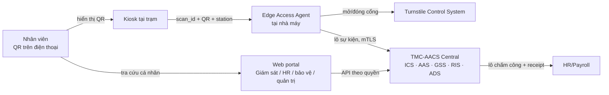

# Bối cảnh sản phẩm

## 1. Vấn đề

Kiểm soát ra vào và chấm công là hai nghiệp vụ gắn với **mỗi lượt đi qua cổng**. TMC cần đồng thời:

- bảo đảm người qua cổng có quyền truy cập;
- ghi nhận chính xác thời gian hiện diện để đối soát chấm công.

Nếu hai việc này xử lý rời rạc, việc phát hiện sai lệch, xử lý tranh chấp và truy vết sự cố sẽ không nhất quán. Giờ giao ca tạo tải tập trung: phản hồi chậm gây ùn tắc; bỏ sót giao dịch làm sai dữ liệu lương.

## 2. Bối cảnh vận hành

| Hạng mục | Giá trị |
|---|---|
| Nhà máy | Bình Dương (~800 người, 6 trạm: 3 vào/3 ra) và Long An (~600 người, 4 trạm: 2 vào/2 ra) |
| Tổng nhân viên | ~1.400 |
| Thiết bị nhân viên | Điện thoại thông minh; QR hiển thị qua app/web/email |
| Thiết bị tại cổng | Kiosk đọc QR, bộ điều khiển cổng quay (turnstile) |
| Hệ thống hiện hữu | HR/Payroll (nhận dữ liệu chấm công qua API), Turnstile Control System (API đóng/mở cổng) |
| Múi giờ | `Asia/Ho_Chi_Minh`; lưu timestamp UTC |
| Tải mục tiêu | 800 giao dịch / 30 phút / nhà máy; burst kiểm thử 10 req/s/nhà máy |
| Hạn chế tháng | Dữ liệu chấm công sẵn sàng đối soát trước **12:00 ngày 01** |

## 3. Mục tiêu và thước đo

| Mục tiêu | Thước đo |
|---|---|
| Kiểm soát đúng quyền, truy vết đầy đủ | Chỉ mở cổng khi QR và quyền hợp lệ; mọi lượt quét (kể cả bị từ chối) có kết quả và dấu vết |
| Chấm công tự động, chính xác | Không sinh bản ghi trùng/sai do hệ thống; phát hiện được lượt vào/ra thiếu |
| Phản hồi nhanh tại cổng | Kiosk phản hồi ≤ 2 giây ở tải 800 giao dịch/30 phút/nhà máy |
| Không mất dữ liệu chấm công | Không mất bản ghi trong vận hành bình thường; đối chiếu được giao dịch với dữ liệu tổng hợp |
| Dữ liệu tháng đúng hạn | Xuất qua API, sẵn sàng đối soát trước 12:00 ngày 01; kết quả chuyển dữ liệu kiểm tra được |
| Bảo vệ dữ liệu cá nhân | RBAC + scope, audit thao tác nhạy cảm, kiểm thử quyền và bảo vệ dữ liệu |
| Dễ bảo trì, mở rộng | Thêm trạm qua cấu hình; thay adapter HR/cổng không sửa nghiệp vụ; rà soát SOLID |

## 4. Ngữ cảnh hệ thống

Ranh giới trách nhiệm của phần mềm: xử lý lượt quét, ghi nhận chấm công, trao đổi API. Điều khiển cơ khí cổng quay và tính lương thuộc hệ thống hiện hữu.

## 5. Ràng buộc thiết kế

| Mã | Ràng buộc | Hệ quả |
|---|---|---|
| A-01 | 6 trạm BD, 4 trạm LA | Tải 800/30 phút không cho biết mức tập trung từng cổng; phải khảo sát |
| A-02 | HR có API đọc hồ sơ, định danh ổn định (nếu có) | Nếu không, nhập dữ liệu được HR duyệt; không ghi ngược hồ sơ vào HR |
| A-03 | API cổng có thể hỗ trợ `command_id` và truy vấn trạng thái | Không retry lệnh không rõ kết quả; dùng `UNKNOWN` + đối soát |
| A-04 | HR nhận lô có `batch_id`, trả kết quả theo bản ghi | Không giả định exactly-once; cần receipt + gửi bù |
| A-05 | LAN ổn định, UPS, VPN giữa hai nhà máy | BD là central, LA là DR; phải khảo sát điện/mạng/ngân sách |
| A-06 | Múi giờ `Asia/Ho_Chi_Minh`, timestamp UTC | Ca qua đêm/ngày công do HR quyết định |
| A-07 | 2–4 lượt quét/người/ngày, 26 ngày/tháng (ước lượng) | Dùng cho dung lượng, không dùng làm cam kết tải |
| A-08 | Lưu sự kiện/audit 5 năm; edge giữ 30 ngày sau đối soát | Chính sách retention/xóa/ẩn danh áp dụng cả backup |
| A-09 | QR là token ký bởi máy chủ, TTL ~60 giây | Email ưu tiên liên kết lấy QR mới; QR tĩnh cần phê duyệt rủi ro riêng |
| A-10 | Quyền/cấu hình offline tin cậy tối đa 30 phút | Hết hạn: dừng tự cấp quyền, bảo vệ xử lý theo quy trình |

## 6. Giả định và rủi ro chính

- Hạ tầng mạng giữa hai nhà máy có thể gián đoạn; **edge phải xử lý cục bộ**.
- API thực tế của HR và turnstile chưa được xác nhận đầy đủ. Mọi adapter phải cô lập hợp đồng và có simulator/contract test.
- Không có camera/sensor xác nhận người đã đi qua. Hệ thống **không** được suy diễn “đã qua cổng” chỉ từ lệnh mở thành công.
- Chống phát lại QR chỉ giảm rủi ro; không ngăn tuyệt đối chụp màn hình hoặc đưa điện thoại cho người khác.
- Tải thực tế có thể dồn cục bộ tại một cổng; cần đo trước khi chốt số kiosk.

## 7. Ngoài phạm vi

Quản lý khách, sinh trắc học, tính lương, thay thế HR/Payroll hoặc hệ thống điều khiển cổng, quy tắc làm thêm giờ/phụ cấp. Xem chi tiết tại [scope.md](scope.md).
