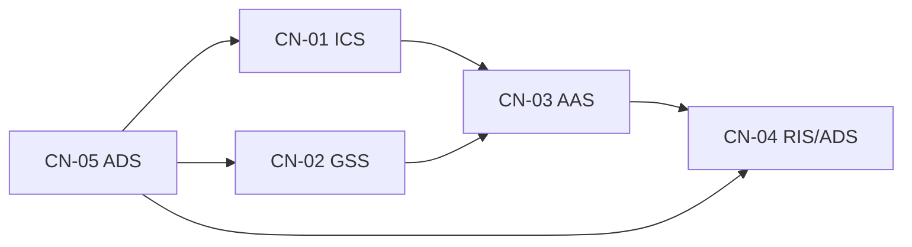

# Yêu cầu chức năng

Mã giữ nguyên từ đặc tả gốc. Trạng thái: ✅ đã có (một phần), ⏳ chưa triển khai.

## Nhóm CN-01 — Quản lý người dùng và QR (ICS)

| Mã | Yêu cầu | Story | Ưu tiên | Trạng thái |
|---|---|---|---|---|
| **FR-U1** | Quản lý định danh, trạng thái và quyền ra vào của nhân viên theo nhà máy; kiểm tra quyền trước khi cho phép truy cập. | US-07 | Cốt lõi | ⏳ |
| **FR-U2** | Cấp, làm mới và thu hồi QR; hỗ trợ hiển thị trên điện thoại qua app, web hoặc email được hỗ trợ. | US-01, US-08 | Cốt lõi | ⏳ |
| **FR-U3** | Dùng QR ký số có thời hạn; thu hồi được phân phối tới trạm; không đưa họ tên, thông tin liên hệ vào mã. | US-01, US-08 | Cốt lõi | ⏳ |
| **FR-U4** | Đồng bộ hồ sơ tối thiểu từ HR nếu có API; không giả định HR hỗ trợ ghi ngược. | US-07 | Hỗ trợ | ⏳ |

**Quy tắc nghiệp vụ**

- Nhân viên bị vô hiệu hóa không được cấp QR mới; QR còn hiệu lực của họ phải bị từ chối khi trạng thái mới đã áp dụng tại trạm.
- QR chứa `issuer`, `audience`, `employee_ref`, `nonce`, `exp`, `key_id`; TTL mục tiêu 60 giây.
- Thu hồi online mục tiêu tới trạm trong 60 giây; offline áp dụng cửa sổ tin cậy 30 phút.

## Nhóm CN-02 — Quản lý trạm cổng (GSS)

| Mã | Yêu cầu | Story | Ưu tiên | Trạng thái |
|---|---|---|---|---|
| **FR-G1** | Đăng ký/cấu hình nhà máy, trạm, kiosk, hướng vào/ra, ánh xạ cổng quay; kích hoạt/vô hiệu hóa trạm. | US-14 | Cốt lõi | ✅ đọc; ⏳ ghi |
| **FR-G2** | Nhận heartbeat, theo dõi kết nối, cảnh báo trạm lỗi; lưu người thay đổi cấu hình. | US-12, US-14 | Cốt lõi | ⏳ |
| **FR-G3** | Cho bảo vệ có quyền yêu cầu mở cổng thủ công, bắt buộc lý do, lưu kết quả; không tự sinh công hợp lệ khi chưa xác minh danh tính. | US-13 | Bổ sung | ⏳ |

**Quy tắc nghiệp vụ**

- Trạm có `station_id`, `factory_id`, `direction`, `gate_id`, `kiosk_id`, `status`, `config_revision`.
- Trạm `INACTIVE`/`MAINTENANCE` không được xử lý như trạm hoạt động.
- Mỗi thay đổi cấu hình tăng `config_revision`; sự kiện quét lưu revision đã dùng.
- Mở thủ công không tạo giao dịch chấm công trừ khi xác định được nhân viên và có bản ghi bổ sung được duyệt.

## Nhóm CN-03 — Ghi nhận sự kiện chấm công (AAS edge + central)

| Mã | Yêu cầu | Story | Ưu tiên | Trạng thái |
|---|---|---|---|---|
| **FR-A1** | Tiếp nhận lượt quét QR, kiểm tra mã và quyền, trả quyết định cho phép/từ chối tại trạm. | US-02 | Cốt lõi | ⏳ |
| **FR-A2** | Gọi API cổng quay cho từng lượt được phép; ghi riêng kết quả quyết định và kết quả điều khiển. | US-02 | Cốt lõi | ⏳ |
| **FR-A3** | Ghi lượt vào/ra thành giao dịch chấm công với nhân viên (nếu xác định được), trạm, hướng, thời điểm, kết quả. | US-02, US-09 | Cốt lõi | ⏳ |
| **FR-A4** | Ghi cả lượt bị từ chối và lỗi thiết bị; cùng `scan_id` gửi lại không tạo thêm sự kiện hoặc lệnh mở cổng. | US-02, US-12 | Cốt lõi | ⏳ |
| **FR-A5** | Giữ sự kiện gốc; hỗ trợ giải trình, xác minh, điều chỉnh có thẩm quyền bằng bản ghi bổ sung. | US-04, US-06, US-10 | Bổ sung | ⏳ |
| **FR-A6** | Khi mất WAN, lưu sự kiện tại nhà máy và chuyển tiếp khi kết nối lại; chỉ dùng chính sách còn hiệu lực. | US-02, US-17 | Cốt lõi | ⏳ |
| **FR-A7** | Chống phát lại QR và phát hiện lượt vào/ra bất thường theo chính sách được phê duyệt; không gộp nhầm lượt quét mới với truyền lại. | US-02, US-09 | Cốt lõi | ⏳ |

**Quy tắc nghiệp vụ**

- Thứ tự bắt buộc: verify token → evaluate policy → **commit event + intent + outbox** → command gate → append outcome.
- Không giữ transaction DB trong lúc gọi thiết bị.
- `scan_id` unique; `command_id` unique; cùng ID khác payload bị từ chối.
- Timeout thiết bị = `UNKNOWN`; không tự coi là mở thành công hoặc thất bại.
- Không suy diễn nhân viên đã đi qua nếu thiếu tín hiệu thiết bị/cảm biến.

## Nhóm CN-04 — Báo cáo và kiểm toán (RIS + ADS)

| Mã | Yêu cầu | Story | Ưu tiên | Trạng thái |
|---|---|---|---|---|
| **FR-R1** | Lập báo cáo chấm công tháng và thông tin giám sát theo nhân viên, đội/ca, nhà máy, phạm vi quyền. | US-05, US-09, US-18 | Cốt lõi | ⏳ |
| **FR-R2** | Cho nhân viên xem lịch sử cá nhân; đánh dấu thiếu lượt vào/ra và kết quả chưa xác định. | US-03, US-09 | Bổ sung | ⏳ |
| **FR-R3** | Xuất dữ liệu chấm công qua API sang HR/Payroll, sẵn sàng đối soát trước 12:00 ngày 01. | US-11 | Cốt lõi | ⏳ |
| **FR-R4** | Quản lý kỳ, phiên bản snapshot, mã lô xuất; theo dõi xác nhận, lỗi, gửi lại an toàn, đối soát phần thiếu. | US-09, US-11 | Cốt lõi | ⏳ |
| **FR-R5** | Ghi và tra cứu audit log cho hành động nhạy cảm: chủ thể, hành động, đối tượng, thời điểm, kết quả, nguồn yêu cầu. | US-16 | Cốt lõi | ⏳ |

**Quy tắc nghiệp vụ**

- Snapshot đã xuất không bị ghi đè; điều chỉnh sau chốt tạo phiên bản/lô bổ sung.
- Số lượng bản ghi bằng nhau chưa đủ; phải đối chiếu khóa nghiệp vụ + checksum/tập ID.
- HTTP 200 từ HR không đồng nghĩa dữ liệu đã được tiếp nhận nghiệp vụ.
- Audit chỉ thêm; checkpoint độc lập để phát hiện sửa chuỗi.

## Nhóm CN-05 — Quản trị hệ thống (ADS)

| Mã | Yêu cầu | Story | Ưu tiên | Trạng thái |
|---|---|---|---|---|
| **FR-S1** | Quản lý tài khoản, vai trò, quyền theo RBAC; giới hạn phạm vi nhà máy/đội/cá nhân ở phía máy chủ. | US-15 | Cốt lõi | ⏳ |
| **FR-S2** | Quản lý cấu hình có phiên bản, tham số hiệu lực QR, chính sách offline, thời hạn lưu dữ liệu theo quyền. | US-14, US-15 | Cốt lõi | ⏳ |
| **FR-S3** | Theo dõi dịch vụ, backlog, sao lưu/phục hồi; lưu bằng chứng và cảnh báo cần xử lý. | US-17 | Cốt lõi | ⏳ |
| **FR-S4** | Hạn chế dữ liệu thu thập, phân quyền liên kết danh tính, áp dụng retention/xóa/ẩn danh đã phê duyệt. | US-03, US-15, US-16 | Cốt lõi | ⏳ |

## Truy vết nhóm chức năng

## Quy tắc chung áp dụng cho mọi FR

1. Mọi thao tác bảo vệ kiểm tra quyền + scope phía máy chủ.
2. Hành động nhạy cảm tạo audit; không log raw QR/PII.
3. Dữ liệu gốc bất biến; sửa sai bằng bản ghi bổ sung có thẩm quyền.
4. Thời gian lưu UTC; hiển thị theo `Asia/Ho_Chi_Minh`.
5. Lỗi phải có mã, thông điệp và `X-Request-Id` để truy vết.
