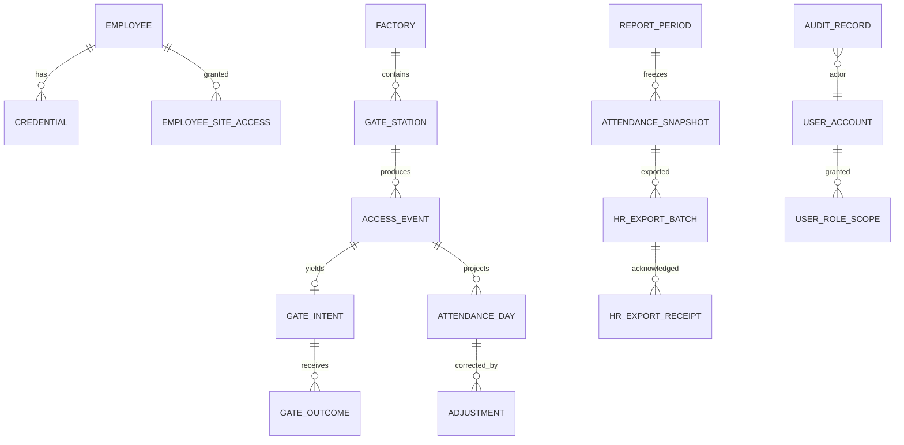

# Mô hình dữ liệu

## 1. Nguyên tắc

1. **Sự kiện là nguồn sự thật.** Access event, decision, gate intent, gate outcome là bất biến. Báo cáo và AttendanceDay là projection có thể rebuild.
2. **ID do server tạo và ổn định.** Chỉ `scan_id` do kiosk tạo (theo hợp đồng), các ID còn lại do server.
3. **Append-only.** Không `UPDATE`/`DELETE` sự kiện, status history, audit, snapshot đã xuất. Sửa sai bằng bản ghi bổ sung.
4. **Schema sở hữu.** Một bảng thuộc đúng một schema/dịch vụ. Không FK/join chéo schema.
5. **UTC.** Cột thời gian là `timestamptz` (ánh xạ `Instant`). Giờ địa phương chỉ tính ở biên hiển thị/nghiệp vụ.

## 2. Thực thể chính

### ICS — danh tính và credential

| Thực thể | Khóa | Trường chính | Ghi chú |
|---|---|---|---|
| `employee` | `employee_ref` | `status`, `full_name` (PII), `factory_ids`, `team_id`, `updated_at` | `employee_ref` là mã giả danh; PII tách riêng nếu cần |
| `employee_site_access` | (`employee_ref`, `factory_id`) | `status`, `effective_from`, `effective_to` | Quyền vào nhà máy |
| `credential` | `credential_id` | `employee_ref`, `status`, `revision`, `key_id`, `issued_at`, `revoked_at` | Không lưu raw QR |
| `signing_key` | `key_id` | `public_key`, `not_before`, `not_after`, `status` | Private key ở KMS/HSM, **không** trong DB ứng dụng |
| `qr_issuance_log` | `issuance_id` | `credential_id`, `issued_at`, `expires_at`, `channel` | Không log token |

### GSS — trạm cổng

| Thực thể | Khóa | Trường chính |
|---|---|---|
| `factory` | `factory_id` | `name`, `code`, `timezone`, `status` |
| `gate_station` | `station_id` | `factory_id`, `name`, `direction`, `gate_id`, `kiosk_id`, `status`, `config_revision` |
| `station_config_history` | `revision_id` | `station_id`, `revision`, `changed_by`, `changed_at`, `before`, `after` |
| `station_heartbeat` | (`station_id`, `observed_at`) | `kiosk_status`, `edge_status`, `agent_version`, `metrics` |
| `manual_open_request` | `request_id` | `station_id`, `requested_by`, `reason`, `result`, `created_at` |

Đã có trong code: `gss.factory`, `gss.gate_station` (xem migration `V2__gss_station.sql`).

### AAS edge — kho sự kiện cục bộ

| Thực thể | Khóa | Trường chính | Ghi chú |
|---|---|---|---|
| `access_event` | `event_id` | `scan_id` (unique), `station_id`, `direction`, `employee_ref`, `occurred_at`, `decision`, `reason_code`, `policy_version`, `payload_fingerprint`, `config_revision` | Bất biến |
| `gate_intent` | `command_id` | `event_id` (unique), `gate_id`, `action`, `created_at`, `state` | Tạo cùng transaction với event |
| `gate_outcome` | `outcome_id` | `command_id`, `outcome` (`CONFIRMED`/`REJECTED`/`FAILED`/`UNKNOWN`), `observed_at`, `detail` | Append; nhiều outcome cho một command nếu đối soát |
| `scan_status_history` | `status_id` | `scan_id`, `status`, `occurred_at`, `detail` | Append-only, projection trạng thái |
| `outbox` | `outbox_id` | `aggregate_type`, `aggregate_id`, `event_type`, `payload`, `created_at`, `published_at`, `attempts` | Relay về central |
| `inbox` | (`source`, `message_id`) | `received_at`, `processed_at` | Khử trùng lệnh/đồng bộ đến |
| `policy_snapshot` | `snapshot_id` | `policy_version`, `revision`, `effective_at`, `expires_at`, `payload`, `signature` | Snapshot đã ký |
| `lease` | `lease_name` | `owner`, `epoch`, `expires_at` | Chặn split-brain |

Đã có trong code: `aas_edge.access_event`, `aas_edge.gate_intent`, `aas_edge.outbox` (migration `V1__edge_event_store.sql`). `gate_outcome` và `scan_status_history` là thiết kế đích, chưa có migration — outcome hiện lưu ở `gate_intent.state` và sẽ được mở rộng khi implement C09.

### AAS central — ingestion và chấm công

| Thực thể | Khóa | Trường chính |
|---|---|---|
| `ingested_event` | `event_id` | `scan_id`, `edge_id`, `payload_hash`, `received_at`, `occurred_at` |
| `attendance_day` | (`employee_ref`, `work_date`, `factory_id`) | `first_in`, `last_out`, `status`, `exception_flags`, `computed_at`, `source_watermark` |
| `attendance_exception` | `exception_id` | `employee_ref`, `work_date`, `type` (`MISSING_IN`/`MISSING_OUT`/`UNKNOWN_OUTCOME`/…), `status` |
| `statement` | `statement_id` | `employee_ref`, `work_date`, `content`, `status`, `submitted_at` |
| `statement_verification` | `verification_id` | `statement_id`, `verifier`, `decision`, `note`, `verified_at` |
| `adjustment` | `adjustment_id` | `employee_ref`, `work_date`, `before`, `after`, `reason`, `proposed_by`, `approved_by`, `approved_at` |

`attendance_day` là projection. Rebuild được từ `ingested_event` + `adjustment`. Không coi là nguồn sự thật khi đối soát.

### RIS — báo cáo và xuất HR

| Thực thể | Khóa | Trường chính |
|---|---|---|
| `report_period` | `period_id` | `year`, `month`, `status`, `opened_at`, `closed_at` |
| `attendance_snapshot` | `snapshot_id` | `period_id`, `factory_id`, `snapshot_version`, `checksum`, `row_count`, `created_at` |
| `snapshot_row` | (`snapshot_id`, `employee_ref`) | Dữ liệu chấm công đã chốt |
| `hr_export_batch` | `batch_id` | `snapshot_id`, `status`, `checksum`, `sent_at`, `attempt` |
| `hr_export_receipt` | `receipt_id` | `batch_id`, `received_count`, `rejected_count`, `unknown_count`, `raw_reference` |
| `hr_export_item_result` | (`batch_id`, `employee_ref`) | `result`, `error_code` |

### ADS — quản trị và audit

| Thực thể | Khóa | Trường chính |
|---|---|---|
| `user_account` | `user_id` | `username`, `status`, `employee_ref` (nullable), `last_login_at` |
| `role` | `role_id` | `name`, `permissions` |
| `user_role_scope` | (`user_id`, `role_id`, `scope_type`, `scope_id`) | `granted_by`, `granted_at`, `expires_at` |
| `config_item` | (`config_key`, `revision`) | `value`, `effective_at`, `changed_by`, `reason` |
| `audit_record` | `audit_id` | `actor`, `action`, `target_type`, `target_id`, `result`, `occurred_at`, `request_id`, `prev_hash`, `record_hash` |
| `audit_checkpoint` | `checkpoint_id` | `from_audit_id`, `to_audit_id`, `hash`, `created_at`, `signature` |
| `retention_policy` | `policy_id` | `data_class`, `retention_days`, `action`, `approved_by` |

## 3. Quan hệ khái niệm

Quan hệ trên là **khái niệm**. Trong DB thật, mỗi thực thể nằm trong schema riêng; tham chiếu chéo chỉ bằng ID, không FK.

## 4. Bất biến dữ liệu (kiểm bằng constraint)

| Bất biến | Cơ chế |
|---|---|
| Một `scan_id` → tối đa một access event | `UNIQUE (scan_id)` trên `access_event` |
| Một event → tối đa một gate intent | `UNIQUE (event_id)` trên `gate_intent` |
| Cùng `scan_id` khác payload bị từ chối | So `payload_fingerprint`; lệch → `409`, ghi audit |
| Một `command_id` không bị dùng lại cho scan khác | `UNIQUE (command_id)`; FK nội schema tới intent |
| `event_id` toàn hệ unique | PK + `UNIQUE` ở central `ingested_event` |
| Snapshot đã xuất không sửa | Không cấp quyền `UPDATE`; trạng thái chuyển bằng bản ghi mới |
| Audit không sửa/xóa | Role ứng dụng chỉ có `INSERT`/`SELECT` trên `ads.audit_record` |
| Không hai writer edge | `lease` + `epoch`; command ghi kèm epoch |
| Timestamp UTC | `timestamptz`, `Instant`; không `LocalDateTime` |

## 5. Dung lượng

Ước lượng: 2.800–5.600 sự kiện/ngày; 72.800–145.600/tháng (2–4 lượt/người/ngày, 26 ngày). Kích thước thô ~1 KB/sự kiện; tổng thực tế lớn hơn do index, status history, audit, WAL và backup. Edge giữ 30 ngày sau đối soát; central giữ sự kiện/audit 5 năm.

## 6. Truy vết

`docs/05-database/schema.md`, ADR-005, ADR-006, ADR-007, ADR-010.
