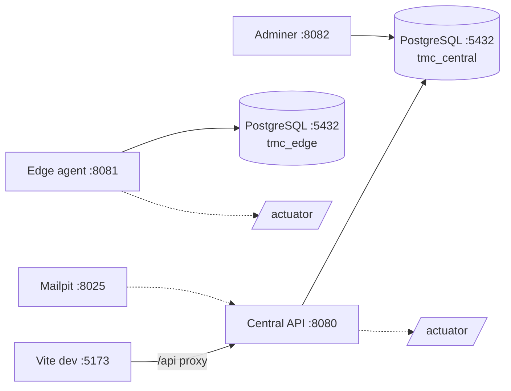
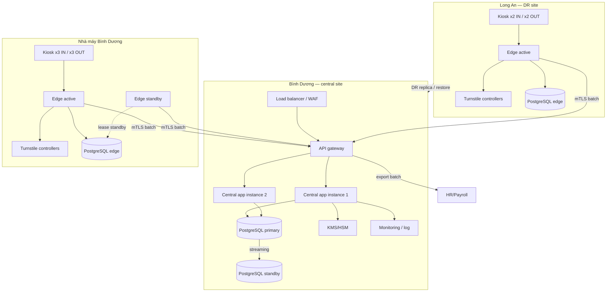

# Triển khai

## 1. Local (hiện tại)

| Thành phần | Cách chạy | Cổng |
|---|---|---|
| PostgreSQL 17 | `make up` | 5432 |
| Adminer | `make up` | 8082 |
| Mailpit | `make up` | 8025 (UI), 1025 (SMTP) |
| Central API | `make backend` hoặc jar | 8080 |
| Edge agent | `make edge` | 8081 |
| Web | `make web` | 5173 |

Container: `tmc-postgres`, `tmc-adminer`, `tmc-mailpit`. DB `tmc_central`, `tmc_edge`; user `tmc`.

## 2. Target topology

## 3. Đơn vị triển khai

| Đơn vị | Số lượng | Ghi chú |
|---|---|---|
| Central API (Spring Modulith) | 2+ instance | Stateless; scale ngang sau LB |
| Edge agent | 1 active + 1 standby / nhà máy | Active/standby, lease + fencing |
| PostgreSQL central | 1 primary + standby | HA, backup PITR |
| PostgreSQL edge | 1 per edge node | Local durable store |
| Gateway | 2+ | TLS, auth sơ bộ, rate limit |
| Kiosk client | Theo trạm | Không giữ khóa ký |

Không tách microservice trong phase hiện tại; xem [ADR-008](../03-decisions/ADR-008-central-modular-monolith.md). Khi tách, giữ nguyên API/event contract.

## 4. Mạng và bảo mật

- Kiosk → edge: HTTPS trong LAN nhà máy; xác thực thiết bị.
- Edge → central: HTTPS + mTLS, outbound từ nhà máy; allowlist đích.
- Web → gateway: TLS; OIDC/SSO.
- Central → HR: TLS + client credential; IP allowlist nếu HR hỗ trợ.
- Không mở DB ra Internet; chỉ app subnet.
- VPN/site link BD–LA có dự phòng; giám sát độ trễ.

## 5. Mục tiêu khả dụng và phục hồi

| Khu vực | Mục tiêu | RTO | RPO |
|---|---|---|---|
| Edge scan path | 99,9%/tháng | 5 phút | 0 cho sự kiện đã xác nhận trong site |
| Central | 99,5%/tháng | 60 phút | Theo backup/replica |
| DR toàn hệ thống | Theo hợp đồng | 4 giờ | Theo snapshot/backup |

- Edge active/standby: chỉ một writer có lease hợp lệ; `epoch` tăng khi chuyển vai trò.
- Backup central: full + WAL/PITR; kiểm restore định kỳ.
- Snapshot tháng được giữ độc lập để tái hiện báo cáo.

## 6. Cấu hình production

| Hạng mục | Yêu cầu |
|---|---|
| Secret | Secret manager; không env file trong image |
| DB credential | User riêng theo dịch vụ; quyền tối thiểu |
| Audit DB role | Chỉ `INSERT`/`SELECT` trên audit |
| TLS | Bắt buộc; từ chối TLS cũ |
| Log | Tập trung, có retention, không chứa PII/raw token |
| Metrics | Prometheus/OTLP; dashboard scan/gate/outbox |
| Alert | Trạm mất kết nối, backlog, lỗi export, `UNKNOWN` tăng |
| Time | NTP nội bộ; cảnh báo lệch |
| Image | Build reproducible, scan lỗ hổng, không chạy root |

## 7. Quy trình phát hành (đề xuất)

1. CI: `make verify` + migration check + contract test.
2. Build image, ký, scan.
3. Deploy staging; chạy smoke + migration dry-run.
4. Backup/verify trước migration production.
5. Deploy central (rolling), sau đó edge theo nhà máy ngoài giờ cao điểm.
6. Theo dõi 30 phút: lỗi, latency, backlog, `UNKNOWN`.
7. Rollback: image trước; migration forward-only, có kế hoạch bù dữ liệu nếu lỗi.

## 8. DR

- BD là central; LA là DR: replica/restore + chạy lại central khi BD không khả dụng.
- Edge ở LA vẫn xử lý cục bộ khi central/DR chưa sẵn sàng.
- Diễn tập: restore DB, chuyển edge vai trò, kiểm tra watermark và đối soát.
- Không chuyển DR tự động nếu chưa có kiểm tra split-brain và fencing.

## 9. Checklist trước go-live

- [ ] Migration chạy trên DB sạch và DB có dữ liệu mẫu.
- [ ] Backup/restore đã diễn tập.
- [ ] mTLS edge–central và cert rotation đã thử.
- [ ] Alert đến đúng người; runbook đã đọc.
- [ ] Load test đạt NFR-P1/P2 với dữ liệu gần thực.
- [ ] Kiểm thử quyền âm/dương theo vai trò + scope.
- [ ] Kịch bản mất WAN, mất edge, timeout cổng đã diễn tập.
- [ ] Kiosk được cấu hình đúng `station_id`, không dùng chung.
