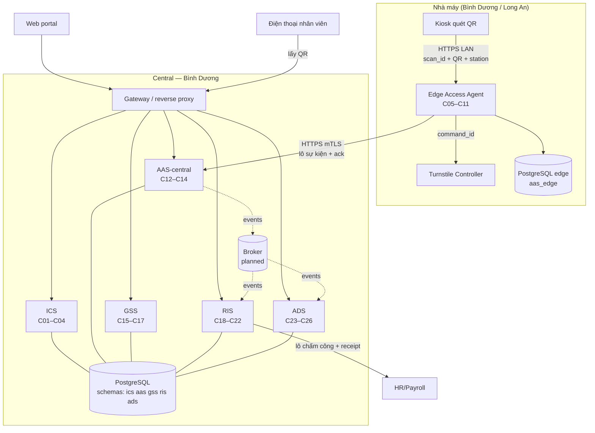

# Tổng quan kiến trúc

## 1. Động lực

| Đặc tính chủ đạo | Hệ quả kiến trúc |
|---|---|
| Reliability / data integrity | Edge lưu bền sự kiện trước khi mở cổng; outbox/inbox; ID ổn định; append-only |
| Performance / responsiveness | Quyết định cổng chạy tại nhà máy; không gọi central/HR trên đường quét |
| Security / privacy / audit | QR ký ngắn hạn; RBAC + scope phía server; audit tách quyền |
| Availability / fault tolerance | Edge active/standby, lease/fencing; chính sách offline có hạn |
| Interoperability | Adapter + contract test cho HR và turnstile; snapshot/lô có đối soát |
| Maintainability / change | Ports & adapters; schema sở hữu; service/module boundary kiểm bằng máy |
| Observability / recoverability | Correlation ID, watermark, backlog, runbook, restore drill |

## 2. Phong cách kiến trúc

**Mục tiêu:** Service-Based Architecture gồm 5 miền lớn (ICS, AAS, GSS, RIS, ADS) + **Edge Access Agent** tại mỗi nhà máy. Quyết định cổng là đồng bộ tại edge; tích hợp nội bộ dùng sự kiện/outbox.

**Hiện tại (Phase 0–1):** central được triển khai như **modular monolith split-ready** bằng Spring Modulith. Các module có ranh giới và schema riêng, được kiểm tra tự động. Khi tải/tổ chức đội cần, tách RIS/ADS/AAS-central thành deployment unit riêng mà không đổi hợp đồng. Edge **luôn là deployment riêng** ngay từ đầu.

Xem [ADR-001](../03-decisions/ADR-001-service-based-with-edge.md) và [ADR-008](../03-decisions/ADR-008-central-modular-monolith.md).

## 3. Dịch vụ và quyền sở hữu dữ liệu

| Dịch vụ | Trách nhiệm | Schema | Thành phần |
|---|---|---|---|
| **ICS** | Hồ sơ tối thiểu, quyền nhà máy, credential QR, khóa ký, thông báo | `ics` | C01–C04 |
| **AAS** | Đường quét (edge) + ingestion/projection/điều chỉnh (central) | `aas` (central), `aas_edge` (edge) | C05–C14 |
| **GSS** | Nhà máy, trạm, kiosk, ánh xạ cổng, heartbeat, mở thủ công | `gss` | C15–C17 |
| **RIS** | Read model báo cáo, kỳ/snapshot, xuất HR, đối soát | `ris` | C18–C22 |
| **ADS** | Tài khoản, vai trò, scope, cấu hình, audit, retention | `ads` | C23–C26 |

Quy tắc: **một schema = một chủ sở hữu**. Không join/ghi chéo schema. Dữ liệu báo cáo là read model dựng từ sự kiện, không đọc trực tiếp kho edge.

## 4. Danh mục thành phần

| Mã | Thành phần | Miền | Trách nhiệm chính |
|---|---|---|---|
| C01 | Employee Directory / HR Reader | ICS | Hồ sơ tối thiểu, quyền nhà máy, đọc HR qua adapter |
| C02 | Credential Manager | ICS | Cấp/thu hồi/phiên bản credential |
| C03 | QR Token Issuer | ICS | Ký token ngắn hạn phía server |
| C04 | Notification Adapter | ICS | Gửi email/liên kết, theo dõi thất bại |
| C05 | Scan Endpoint | AAS-Edge | Nhận `scan_id`, xác thực kiosk, trả kết quả |
| C06 | QR Verifier | AAS-Edge | Chữ ký, issuer, audience, hạn, `key_id` |
| C07 | Access Policy Engine | AAS-Edge | Quyền nhà máy, trạng thái, chống phát lại, quy tắc vào/ra |
| C08 | Attendance Recorder | AAS-Edge | Transaction event + intent + outbox |
| C09 | Gate Commander | AAS-Edge | `command_id`, gọi cổng, ghi outcome |
| C10 | Policy / Credential Sync | AAS-Edge | Snapshot quyền/khóa/cấu hình có version |
| C11 | Event Forwarder | AAS-Edge | Gửi bù theo cursor, ack, backoff |
| C12 | Event Ingestor | AAS-Central | Nhận lô, khử trùng, commit sự kiện |
| C13 | Attendance Projector | AAS-Central | Tổng hợp hiện diện, gắn cờ ngoại lệ |
| C14 | Adjustment Workflow | AAS-Central | Giải trình, xác minh, phê duyệt, bản ghi bù |
| C15 | Station Registry | GSS | Nhà máy, trạm, hướng, mapping thiết bị |
| C16 | Station Health | GSS | Heartbeat, tình trạng, cảnh báo |
| C17 | Manual Access Coordinator | GSS | Yêu cầu mở thủ công có quyền + lý do |
| C18 | Report Builder | RIS | Báo cáo cá nhân/đội/nhà máy theo quyền |
| C19 | Dashboard Query | RIS | Read model tổng hợp + thời điểm cập nhật |
| C20 | Period / Snapshot Manager | RIS | Khóa snapshot có version, phát hiện nguồn thiếu |
| C21 | HR Export Adapter | RIS | Ánh xạ, gửi lô, truy vấn receipt |
| C22 | Reconciliation Service | RIS | So khớp tập ID, bản ghi nhận, phần thiếu |
| C23 | Identity / Authorization | ADS | Tài khoản, vai trò, policy, scope |
| C24 | Audit Writer / Reader | ADS | Ghi/đọc audit, checkpoint |
| C25 | Configuration Manager | ADS | Cấu hình có version và phân phối |
| C26 | Privacy / Retention | ADS | Chính sách dữ liệu, xử lý theo thẩm quyền |

## 5. Giao tiếp

| Kết nối | Kiểu | Bảo đảm/lỗi |
|---|---|---|
| Kiosk → C05 | HTTPS LAN | Xác thực kiosk; cùng `scan_id` giữ nguyên nội dung; retry trả kết quả đã lưu |
| C09 → turnstile | HTTP(S) qua adapter | Timeout 700 ms; mất phản hồi = `UNKNOWN`; chỉ retry nếu có idempotency xác nhận |
| C11 → C12 | HTTPS mTLS theo lô | `event_id`, `scan_id`, `version`, `schema_version`; ack sau commit |
| ICS/GSS/ADS → C10 | Snapshot/delta có revision | `effective_at`, `expires_at`; không nhận revision cũ; thu hồi online mục tiêu 60 giây |
| Central services | Sự kiện qua broker (planned) | Outbox commit cùng dữ liệu; inbox commit cùng cập nhật; dead-letter + cảnh báo |
| C21 → HR | API lô | `batch_id`, `period`, `snapshot_version`, checksum; receipt nghiệp vụ |
| Web → gateway → service | HTTPS | Gateway kiểm tra sơ bộ; **mỗi service tự kiểm tra quyền + scope** |

## 6. Các quyết định chi phối

- [ADR-001](../03-decisions/ADR-001-service-based-with-edge.md) — service-based + edge.
- [ADR-002](../03-decisions/ADR-002-ports-and-adapters.md) — ports & adapters.
- [ADR-003](../03-decisions/ADR-003-react-spring-postgres.md) — React + Spring Boot + PostgreSQL.
- [ADR-005](../03-decisions/ADR-005-commit-evidence-before-gate.md) — commit chứng cứ trước tác động.
- [ADR-006](../03-decisions/ADR-006-outbox-inbox-idempotency.md) — outbox/inbox.
- [ADR-007](../03-decisions/ADR-007-postgres-schema-per-service.md) — schema per service.
- [ADR-008](../03-decisions/ADR-008-central-modular-monolith.md) — central modular monolith giai đoạn đầu.

## 7. Tổng hợp 4+1

| Góc nhìn | Câu hỏi | Tài liệu |
|---|---|---|
| Logical | Trách nhiệm, đối tượng, quan hệ? | Tài liệu này + [data-model.md](data-model.md) |
| Process | Tiến trình, commit, phục hồi? | [scan-pipeline.md](scan-pipeline.md) + [edge-central-sync.md](edge-central-sync.md) |
| Development | Mã chia thế nào, phụ thuộc ra sao? | [tech-stack.md](tech-stack.md) + `AGENTS.md` |
| Physical | Chạy ở đâu, chịu lỗi gì? | [deployment.md](deployment.md) |
| Scenarios (+1) | Các view có giải quyết cùng kịch bản? | NFR QS-01…QS-07 + testing matrix |

## 8. Trạng thái code hiện tại

| Thành phần | Trạng thái |
|---|---|
| Central Spring Modulith + module boundaries | ✅ |
| GSS đọc trạm từ `gss` schema | ✅ |
| System status + DB probe | ✅ |
| Flyway 5 schema central + `aas_edge` | ✅ |
| Edge app + event store schema | ✅ khung |
| C05–C11 scan pipeline | ⏳ |
| ICS credential/QR | ⏳ |
| Auth/RBAC/audit | ⏳ |
| Broker, outbox relay, ingestion | ⏳ |

Chi tiết triển khai theo phase: [roadmap](../06-development/roadmap.md).
