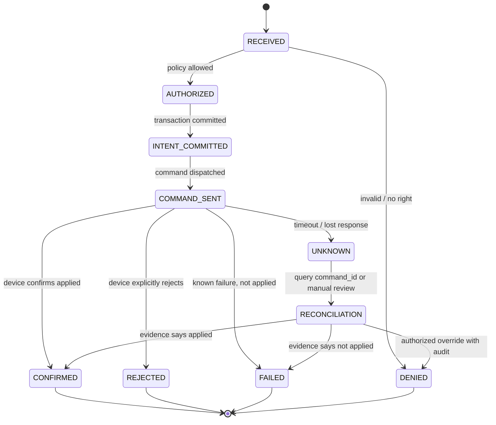

# Đường quét QR (scan pipeline)

Đây là đường găng của hệ thống. Mọi thay đổi trong tài liệu này phải giữ các bất biến trong `AGENTS.md` §3.

## 1. Thành phần

| Mã | Thành phần | Vai trò |
|---|---|---|
| C05 | Scan Endpoint | Nhận request từ kiosk, xác thực danh tính trạm, trả kết quả |
| C06 | QR Verifier | Kiểm tra chữ ký, issuer, audience, hạn, `key_id`, nonce |
| C07 | Access Policy Engine | Quyết định cho phép/từ chối, kèm lý do + `policy_version` |
| C08 | Attendance Recorder | Ghi event + decision + intent + outbox trong một transaction |
| C09 | Gate Commander | Gửi lệnh theo `command_id`, ghi outcome |
| C10 | Policy / Credential Sync | Cung cấp snapshot quyền, khóa công khai, cấu hình có revision |
| C11 | Event Forwarder | Gửi lô sự kiện đã commit về central, nhận ack |

Kiosk tạo `scan_id` và **giữ nguyên** khi retry.

## 2. Trình tự thành công

```mermaid
sequenceDiagram
    autonumber
    participant K as Kiosk
    participant E as Edge C05
    participant V as C06 QR Verifier
    participant P as C07 Policy
    participant R as C08 Recorder
    participant DB as PostgreSQL edge
    participant G as C09 Gate
    participant T as Turnstile

    K->>E: POST /scans {scan_id, station_id, token, direction}
    E->>V: verify(token, station, now)
    V-->>E: claims + key_id + policy snapshot
    E->>P: evaluate(claims, station, history)
    P-->>E: ALLOWED + policy_version
    E->>R: commit decision + intent + outbox
    R->>DB: BEGIN; INSERT event/status/intent/outbox; COMMIT
    DB-->>R: durable
    E->>G: execute(command_id, gate_id, action, deadline)
    G->>T: open/close
    T-->>G: confirmed / rejected / timeout
    G-->>E: GateOutcome
    E->>R: append outcome + outbox
    R->>DB: COMMIT
    E-->>K: result (≤ 2s total)
    Note over R,DB: C11 gửi lô nền; ack sau khi central commit
```

**Thứ tự bất biến:** `event + decision + intent + outbox` phải commit **trước** khi gửi lệnh tới turnstile. Nếu ghi intent thất bại, **không** gọi thiết bị.

Lượt bị từ chối vẫn ghi event + decision + outbox nhưng **không** tạo intent/command.

## 3. State machine

Các trạng thái là **projection** dựng từ lịch sử chỉ thêm; không UPDATE đè trạng thái cũ.



`UNKNOWN` không được map thành công hoặc thất bại. `CONFIRMED` chỉ khi thiết bị xác nhận; không suy ra từ HTTP 200 nếu hợp đồng chỉ là “accepted”.

## 4. Thuật toán điều phối (pseudocode)

```java
ScanResult handle(ScanCommand scan, Ports ports, AccessPolicy policy, Deadline deadline) {
    // 1. Retry của cùng scan_id phải trả cùng kết quả, không tạo side effect mới
    var prior = ports.eventStore.findByScanId(scan.id());
    if (prior.isPresent()) {
        return prior.get().safeResult(); // kể cả DENIED / UNKNOWN
    }

    // 2. Verify + policy (không gọi central/HR)
    var claims = ports.qrVerifier.verify(scan.token(), scan.stationId(), ports.clock.now());
    var decision = policy.evaluate(claims, scan, ports.policySnapshot.current());

    // 3. Commit chứng cứ trước tác động; unique constraint chống race
    var intent = ports.eventStore.commitDecisionAndIntent(scan, decision);
    if (!decision.allowed()) {
        return intent.deniedResult();
    }

    // 4. Chỉ sau commit mới gọi thiết bị
    var outcome = ports.gate.execute(intent.command(), deadline);
    ports.eventStore.appendOutcome(intent, outcome);

    return toScanResult(outcome); // UNKNOWN không bao giờ là success
}
```

`findByScanId` chỉ là fast-path. Tính đúng đắn phải dựa trên **unique constraint** `scan_id` và transaction: hai request đồng thời, một request thắng, request còn lại đọc intent/kết quả đã có.

## 5. Ma trận idempotency

| Tình huống | Hành vi bắt buộc |
|---|---|
| Cùng `scan_id`, cùng payload, trước khi gửi lệnh | Trả kết quả đã lưu; không tạo event/intent mới |
| Cùng `scan_id`, cùng payload, sau khi đã gửi lệnh | Trả trạng thái hiện tại (`COMMAND_SENT`/`UNKNOWN`/...) |
| Cùng `scan_id`, payload khác (token/station/direction) | Từ chối `409`/`422`; ghi audit; không merge |
| Hai request đồng thời cùng `scan_id` | Unique constraint; chỉ một event/intent; request thua đọc kết quả thắng |
| Retry sau khi mất phản hồi từ edge | Trả kết quả đã lưu; không gọi cổng lần hai |
| Crash sau commit intent, trước gọi cổng | Recovery chỉ gửi lệnh nếu chứng minh được lệnh chưa từng gửi; nếu không chắc → `UNKNOWN` + đối soát |
| Crash sau khi cổng đã mở, trước khi ghi outcome | Giữ intent; **không** tạo command mới; đối soát theo `command_id` |
| Timeout cổng | `UNKNOWN`; query `command_id` nếu adapter hỗ trợ; không retry mù |
| Cùng `event_id` gửi lại central | Inbox/unique key bỏ qua; ack lại; không nhân đôi projection |
| Cùng `batch_id` gửi lại HR | Không tạo lô mới; đối soát receipt cũ trước khi gửi bù |

## 6. Lý do từ chối (stable codes)

`INVALID_SIGNATURE`, `EXPIRED_TOKEN`, `NOT_YET_VALID`, `WRONG_ISSUER`, `WRONG_AUDIENCE`, `UNKNOWN_KEY_ID`, `MALFORMED_TOKEN`, `EMPLOYEE_UNKNOWN`, `EMPLOYEE_INACTIVE`, `NO_SITE_ACCESS`, `STATION_INACTIVE`, `STATION_MAINTENANCE`, `WRONG_DIRECTION`, `ANTI_PASSBACK`, `POLICY_STALE`, `POLICY_MISSING`, `STORE_UNAVAILABLE`, `REPLAY_DETECTED`.

Không trả chi tiết nhạy cảm cho kiosk nhiều hơn mức cần thiết; log mã lý do + `scan_id`, không log raw token.

## 7. Policy snapshot và cửa sổ tin cậy

- Snapshot chứa `policy_version`, `revision`, `effective_at`, `expires_at`, public keys + `key_id`, quyền nhà máy, trạng thái nhân viên/credential, cấu hình trạm.
- Edge chỉ dùng snapshot còn hiệu lực. Thu hồi online mục tiêu 60 giây.
- Mất WAN: tiếp tục trong tối đa **30 phút** nếu snapshot còn hạn và local store ghi được.
- Hết hạn / thiếu quorum / không ghi được intent: **dừng tự cấp quyền**, trả lỗi có nghĩa, chuyển quy trình bảo vệ có audit. Không mở tất cả cổng.
- Kiosk không giữ khóa ký; chỉ edge giữ public key để verify.

## 8. Ngân sách độ trễ

Xem bảng đầy đủ tại [NFR §4](../01-requirements/non-functional-requirements.md#4-khối-lượng-và-ngân-sách-độ-trễ). Tóm tắt: 1.600 ms xử lý + 400 ms dự phòng. Timeout turnstile ban đầu 700 ms nằm trong tổng ngân sách, không cộng thêm ngoài.

## 9. Failure modes

| Sự cố | Hành vi |
|---|---|
| WAN mất | Edge xử lý trong cửa sổ tin cậy; outbox tích lũy; heartbeat/cảnh báo |
| Turnstile timeout | `UNKNOWN`, phản hồi không thành công giả; đối soát theo `command_id` |
| Edge active chết | Standby chỉ nhận vai trò sau lease/fencing + kiểm tra dữ liệu; không đủ điều kiện thì dừng |
| Đầy đĩa / lỗi ghi | Không gửi lệnh mở cổng; cảnh báo sớm; bảo vệ xử lý có nhật ký |
| Central/broker lỗi | Edge vẫn xử lý; dữ liệu/outbox chưa ack được giữ; replay khử trùng |
| Policy hết hạn | Từ chối tự động; chuyển thủ công; audit |
| Kiosk gửi payload lệch cùng `scan_id` | Từ chối; không tạo tác động |
| Ghi outcome thất bại sau khi cổng mở | Giữ intent; recovery/đối soát; không tạo command mới |

## 10. Kiểm thử bắt buộc

1. Token hợp lệ → 1 event, 1 intent, 1 command, `CONFIRMED`.
2. Token sai/hết hạn/sai audience/khóa cũ → `DENIED`, 0 command, có event.
3. Nhân viên inactive / không có quyền nhà máy → `DENIED`, có lý do.
4. Cùng `scan_id` gửi tuần tự → cùng kết quả, 1 event.
5. Hai request đồng thời cùng `scan_id` → 1 event, 1 command.
6. Timeout cổng → `UNKNOWN`; không success; retry không tạo command mới.
7. Crash trước commit → không có lệnh; crash sau commit trước gửi → recovery an toàn.
8. Cổng đã mở nhưng mất phản hồi → intent còn, `UNKNOWN`, đối soát.
9. Mất WAN trước/sau mốc 30 phút → hành vi đúng cửa sổ tin cậy.
10. Outbox: commit nhưng chưa publish; publish nhưng mất ack; consumer restart → không mất/không nhân đôi.
11. Đo tải 800/30 phút + burst 10 req/s; báo cáo max/p95/p99 và số vi phạm 2 giây.

## 11. Truy vết

FR-A1–A7, NFR-P1/P2/R1/R2/A1/O1, QS-01–QS-04, SC-01–SC-04, AR-01/02/03/12.
