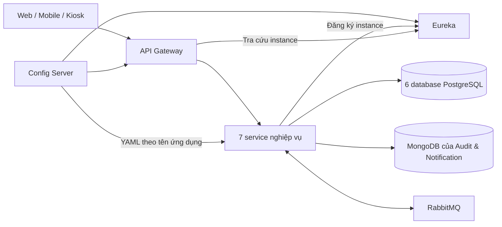
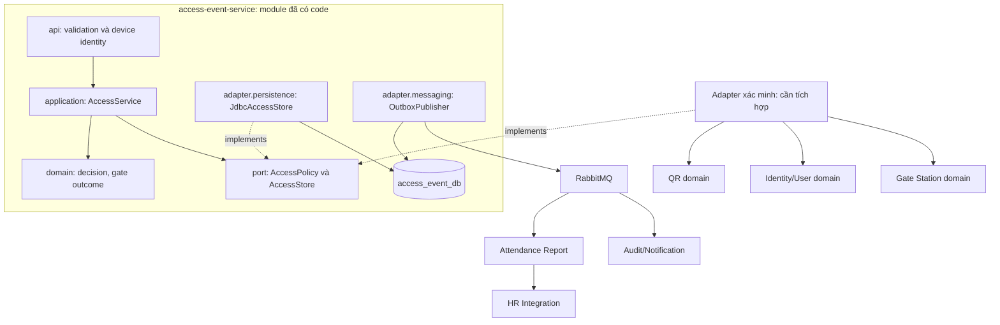
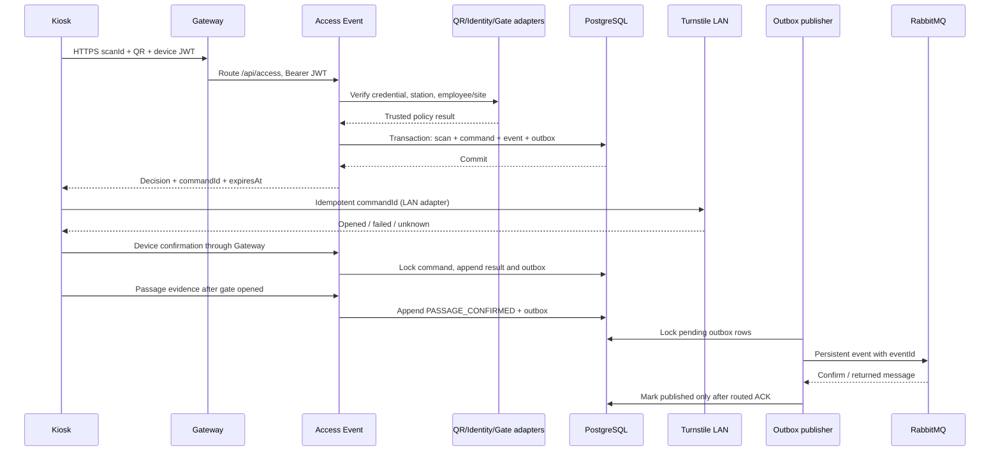
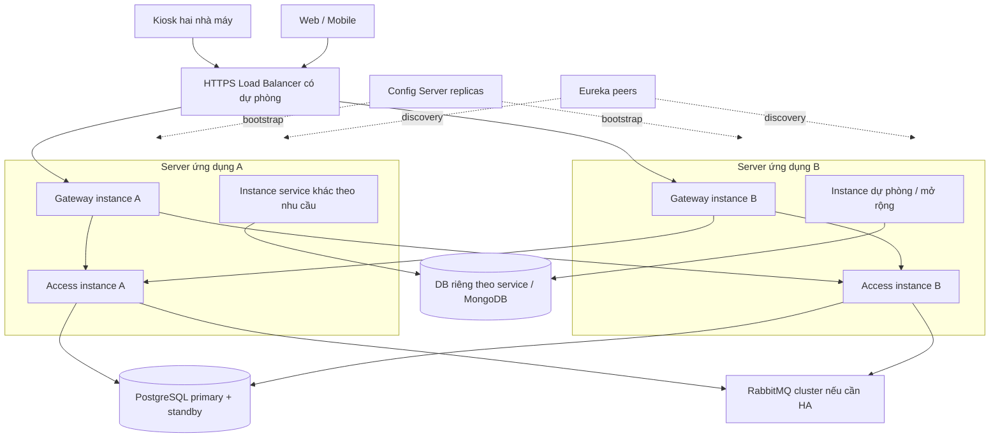

# Kiến trúc backend

## 1. Tổ chức ứng dụng

Tất cả ứng dụng đặt dưới `services/<service>/`. Mỗi ứng dụng là project Maven độc lập; thư mục `backend` không có POM tổng hợp. `infra/` giữ script khởi tạo dữ liệu, `docs/` giữ tài liệu setup và kiến trúc.

Repository dùng 7 service nghiệp vụ, mỗi service có POM, package và cấu hình ứng dụng riêng. Ba ứng dụng hạ tầng là Config Server, Discovery Server và API Gateway.

Phần dưới xác định ranh giới trách nhiệm để phát triển nghiệp vụ. Danh sách trách nhiệm không phải danh sách endpoint controller đã được cài đặt.

| Service | Package | Trách nhiệm |
|---|---|---|
| Identity & User | `com.tmc.identityuser` | Nhân viên, tài khoản, đăng nhập, RBAC và quyền vào nhà máy |
| QR | `com.tmc.qr` | Cấp/thu hồi credential, QR động có chữ ký và thông tin xác minh |
| Gate Station | `com.tmc.gatestation` | Nhà máy, cổng, kiosk/scanner, cấu hình và hợp đồng adapter thiết bị |
| Access & Attendance Event | `com.tmc.accessevent` | Nhận scan, kiểm quyền/QR, quyết định truy cập, quản lý lệnh cổng và sự kiện vào/ra |
| Attendance Report | `com.tmc.attendancereport` | Tổng hợp công, ngoại lệ/điều chỉnh, báo cáo và snapshot kỳ công |
| HR/Payroll Integration | `com.tmc.hrintegration` | Mapping, export, retry, receipt và đối soát với HR/Payroll |
| Audit & Notification | `com.tmc.auditnotification` | Audit nghiệp vụ và gửi thông báo, tách module/luồng xử lý |

### Package Java trong mỗi service

Các service nghiệp vụ tổ chức theo layer dưới `src/main/java/com/tmc/<service>/`:

```text
├── controller/   # REST endpoint, nhận request và trả response
├── service/      # Nghiệp vụ, điều phối và transaction
├── entity/       # Model dữ liệu và enum nghiệp vụ
├── repository/   # Truy cập PostgreSQL hoặc MongoDB
├── dto/          # Request, response và hợp đồng trao đổi dữ liệu
├── config/       # Security, OAuth2, signing key và cấu hình Spring
├── client/       # Gọi API của service/hệ thống khác
├── messaging/    # Consumer, outbox publisher và giám sát sự kiện
├── exception/    # Xử lý lỗi HTTP riêng của service
└── utils/        # Hàm tiện ích thuần, ví dụ SHA-256
```

Service được controller sử dụng khai báo interface tại `service/XxxService.java`; implementation tương ứng nằm tại `service/impl/XxxServiceImpl.java`. Controller, consumer và scheduler tiếp tục inject interface. Annotation Spring và transaction đặt ở implementation; giữ tên bean hiện có. Các helper như `IdentityAccess`, `AttendanceCalculator` và worker giữ class trực tiếp khi không cần hợp đồng interface riêng.

```text
service/
├── XxxService.java          # Interface nghiệp vụ
└── impl/
    └── XxxServiceImpl.java  # Implementation
```

Chỉ tạo package khi có class sử dụng; các ứng dụng hạ tầng giữ các package cần thiết. DTO công khai nằm trong file riêng; enum gắn trực tiếp với entity có thể nằm trong entity đó. Repository SQL hiện dùng JDBC, giữ Flyway quản lý schema; thư mục `entity` không mặc định đồng nghĩa với JPA entity. Giữ package gốc của ứng dụng và ranh giới database theo service.

## 2. Thành phần hạ tầng

| Ứng dụng | Package | Vai trò |
|---|---|---|
| Config Server | `com.tmc.config` | Phục vụ cấu hình từ `configurations` bằng native filesystem/classpath repository |
| Discovery Server | `com.tmc.discovery` | Eureka registry, cấu hình local chạy standalone |
| API Gateway | `com.tmc.gateway` | Gateway MVC, route tường minh và cân bằng tải tới service qua tên Eureka |

Eureka cung cấp danh sách instance; Spring Cloud LoadBalancer chọn instance khi gọi service. Config Server không quản lý số instance. Cấu hình RabbitMQ, database và SMTP thuộc phần hạ tầng hỗ trợ.



Mũi tên database là quan hệ tổng quát của nhóm service. Audit & Notification chỉ dùng MongoDB; sáu service còn lại dùng PostgreSQL.

## 3. Dữ liệu theo service

| Service | Database | Username PostgreSQL/MongoDB local |
|---|---|---|
| Identity & User | `identity_user_db` | `identity_app` |
| QR | `qr_db` | `qr_app` |
| Gate Station | `gate_station_db` | `gate_station_app` |
| Access & Attendance Event | `access_event_db` | `access_event_app` |
| Attendance Report | `attendance_report_db` | `attendance_report_app` |
| HR Integration | `hr_integration_db` | `hr_integration_app` |
| Audit & Notification | `audit_notification_db` | `audit_app` |

Database là database logic riêng theo service. Sáu database PostgreSQL có thể đặt trên cùng server/cụm. Mỗi service truy cập dữ liệu của mình; giao tiếp với miền khác qua API/sự kiện thay vì join hoặc ghi chéo database.

Các service SQL hiện truy cập dữ liệu bằng JDBC; POM có Spring Data JPA, PostgreSQL Driver và Flyway. Cấu hình `ddl-auto: validate` áp dụng khi có mapping JPA, không tự tạo bảng; thêm thay đổi schema bằng migration của từng service. Audit & Notification dùng Spring Data MongoDB, không dùng JPA hoặc Flyway PostgreSQL.

## 4. Dependency theo bộ khung hiện tại

Các service nghiệp vụ đều có Web MVC, Validation, OAuth2 Resource Server, RabbitMQ, Eureka Client, Config Client, Actuator và Lombok.

| Nhóm/service | Dependency riêng |
|---|---|
| Sáu service SQL | Spring Data JPA, PostgreSQL Driver, Flyway và module Flyway PostgreSQL |
| Identity & User | OAuth2 Authorization Server |
| Gate Station, HR Integration | Spring Cloud LoadBalancer |
| Audit & Notification | Spring Data MongoDB, Mail |
| Config Server | Config Server, Actuator, Spring Security |
| Discovery Server | Eureka Server, Config Client, Actuator, Spring Security |
| API Gateway | Gateway Server Web MVC, LoadBalancer, Eureka Client, Config Client, OAuth2 Resource Server, Actuator |

POM đang dùng tên starter RabbitMQ của Boot 4.2 là `spring-boot-starter-rabbitmq`. Gateway dùng `spring-cloud-starter-gateway-server-webmvc`; giữ cấu hình route dưới `spring.cloud.gateway.server.webmvc`.

## 5. Bảo mật

Lớp cấu hình đặt trong package `config`, theo quy ước của TicketBooking. Gateway tách `SecurityConfig` (route authorization, session policy, CORS) và `JwtConfig` (chuyển claim JWT thành authorities). TMC giữ quy ước OAuth2 scope thành `SCOPE_*`; không chuyển sang claim `permissions` của dự án tham khảo khi Identity chưa phát claim này. Config Server và Discovery có `config/SecurityConfig` riêng để bảo vệ endpoint hạ tầng.

- Identity & User có vai trò Authorization Server để cấp token và Resource Server để bảo vệ API của chính nó.
- Sáu service nghiệp vụ còn lại và Gateway là Resource Server, xác minh token API bằng issuer và JWKS được cấu hình tập trung.
- Gateway dùng SecurityFilterChain của Spring MVC, CORS theo danh sách origin và Bearer JWT stateless. Metadata/JWKS và token endpoint của Identity được whitelist riêng để không buộc client có access token trước khi xin token.
- Config Server và Eureka dùng HTTP Basic cho endpoint hạ tầng. Health endpoint được phép truy cập không cần credential.
- JWT truy cập API và token trong QR phục vụ hai mục đích khác nhau. Cấp QR không biến QR Service thành Authorization Server.
- Public key và thông tin thu hồi QR là hợp đồng giữa QR và Access; quyền nhà máy thuộc Identity & User.

Identity đã có client credentials cho kiosk/service, Authorization Code + PKCE cho người dùng, lưu trữ OAuth bằng JDBC và nạp signing key từ file riêng bền vững. Đăng ký thiết bị/phân quyền dựa trên dữ liệu quản lý, không lấy station tùy ý từ request xin token. Hợp đồng và giới hạn triển khai nằm trong [identity-api.md](identity-api.md).

Auth của TMC tiếp tục theo OAuth2 Authorization Server. Các endpoint custom login/refresh và cách tự ký JWT của dự án tham khảo không được coi là API có sẵn trong TMC. Đường JWKS hiện tại là `/oauth2/jwks`; các client nhận URI này qua cấu hình tập trung.

## 6. Ranh giới tích hợp thiết bị

Backend và database chạy trên server thuê. Kiosk gửi yêu cầu quét, nhận quyết định/lệnh và giao tiếp với turnstile qua adapter phù hợp API thiết bị. Kiosk không sở hữu database nghiệp vụ hoặc tự quyết định quyền khi mất kết nối trung tâm.

Gate Station quản lý cấu hình/hợp đồng adapter. Access quản lý quyết định, ID lệnh và sự kiện/kết quả của lượt truy cập. Phải phân biệt được phép vào, cổng xác nhận mở và người thực sự đi qua.

## 7. Đóng gói

Mỗi ứng dụng đóng gói JAR độc lập và có thể có Docker image riêng khi triển khai. Nhiều instance của cùng service dùng chung database do service đó sở hữu. Chạy nhiều instance không làm thay đổi số service nghiệp vụ.

Hướng dẫn local chạy Java trực tiếp bằng IDE/Maven và kết nối tới database, RabbitMQ, SMTP đã được chuẩn bị.

## 8. So sánh và lựa chọn architecture style

| Phương án | Điểm phù hợp | Đánh đổi trong TMC |
|---|---|---|
| Layered monolith | Build/deploy đơn giản, transaction nội bộ thuận tiện | Report/export và scan cùng miền lỗi, khó mở rộng độc lập |
| Modular monolith | Giữ domain rõ, ít giao tiếp mạng hơn | Vẫn chung đơn vị triển khai; là lựa chọn hợp lý nếu đội nhỏ ưu tiên vận hành |
| Microservices theo 7 domain hiện tại | Tách owner dữ liệu, nhịp phát triển và mở rộng đường scan | Thêm timeout, eventual consistency, vận hành và kiểm thử phân tán |
| Event-driven integration | Report, audit và HR không chặn đường scan | Cần outbox, dedup, retry/DLQ và theo dõi độ trễ |

Chọn microservices với phân lớp bên trong từng service và tích hợp sự kiện khi cần theo quyết định người dùng. Mức tải trung bình của đề không tự bắt buộc microservices; lựa chọn này ưu tiên ranh giới domain và khả năng triển khai độc lập, chấp nhận chi phí hệ thống phân tán. Không chia nhỏ thêm service để chỉ bọc CRUD.

## 9. Logical architecture và module view

Các bước xây dựng: xác định actors/use case từ đề → nhóm invariant và dữ liệu theo domain → chốt owner → định nghĩa API/event → đặt transaction và retry tại biên → ánh xạ vào các service hiện có → kiểm chứng luồng thực trước khi mở rộng.



Biểu đồ phân biệt module đã có code với các tích hợp cần hoàn thiện. Các service tuân theo owner ở mục 1; mức triển khai thực tế nằm trong `PROGRESS.md`. Access không đọc database của Identity/QR/Gate; consumer không chia sẻ bảng Access. POM từng service là đơn vị build; mã Java bên trong tổ chức theo layer như `controller`, `service`, `repository`, `entity` và `dto`.

## 10. Component-and-connector view



HTTPS request/response nằm trên đường găng; RabbitMQ chuyển dữ liệu tới Report/Audit/HR bất đồng bộ. Consumer dùng queue riêng theo mục đích, dedup `eventId` và ACK sau commit. Replay/retry không tạo lượt hoặc lệnh mới; broker outage không làm mất outbox đã commit. Nếu response scan mất, kiosk retry ID cũ; không suy đoán lệnh chưa được tạo.

Sơ đồ là luồng đích: policy/service thật, kiosk/turnstile và consumer còn cần tích hợp. Contract hiện có được mô tả trong [access-api.md](access-api.md).

## 11. Physical architecture và allocation view

Thiết kế đích trên server thuê, không mô tả topology đang được triển khai. Bước phân bổ: ước lượng đường scan và connection pool → tách ứng dụng khỏi data tier → phân bố instance qua miền lỗi → thiết lập health/TLS/secret → kiểm chứng failover và tải → điều chỉnh theo số liệu.



- Tối thiểu hai instance Gateway/Access đặt trên hai server/miền lỗi khác nhau khi yêu cầu dự phòng. Hai process cùng một máy không chịu được lỗi máy đó. Instance cùng service dùng chung database do service sở hữu.
- Mỗi instance có `instance-id` khác nhau, port và secret phù hợp. Eureka và LoadBalancer chỉ hướng request tới instance; không tự tạo thêm process hoặc tự mở rộng theo giờ đổi ca. Việc bật/tắt instance thuộc deployment và cần drain khi dừng.
- Config Server replicas dùng cùng phiên bản kho YAML; Eureka peers có cấu hình peer riêng. YAML local hiện standalone, chưa chứng minh HA. Service giữ cấu hình đã nạp khi Config Server tạm ngắt; bootstrap mới vẫn cần config khả dụng.
- PostgreSQL cần backup/restore, replication và quy trình failover tránh split-brain. MongoDB cần replica set nếu yêu cầu HA. Broker quorum queues thường cần ít nhất ba node độc lập để chịu lỗi một node; một broker đơn vẫn là điểm lỗi chung.
- Data/broker ports chỉ mở trong mạng riêng. Public entry là HTTPS LB/Gateway; API quản trị/Eureka/Config hạn chế truy cập, credential nằm ngoài source.
- Giới hạn tổng connection tính theo số instance và pool từng service. Report/export chạy ngoài đường scan; deadline HR và độ trễ consumer được giám sát riêng.

Các con số replica, pool và topology là thiết kế cần đo/triển khai, không phải bằng chứng SLA hoặc khả năng đáp ứng ≤ 2 giây. Không có runtime deployment/failover thực thì chưa nghiệm thu HA.

## 12. Architectural decisions và hệ quả

| ADR | Quyết định | Lý do và đánh đổi |
|---|---|---|
| ADR-01 | 7 business services Java, 3 app hạ tầng | Theo ranh giới đã chốt; thay đề xuất M1 5 service/NestJS; tăng chi phí tích hợp |
| ADR-02 | DB logic và tài khoản riêng; không join xuyên service | Tách ownership/migration; dữ liệu liên service nhất quán cuối cùng |
| ADR-03 | QR ký số, TTL ngắn; Access tiêu thụ QR nguyên tử | Giảm ảnh chụp/replay; cần khóa bền vững, thu hồi và xác minh site; không loại bỏ hoàn toàn gian lận |
| ADR-04 | Event append-only và transactional outbox | Không dual-write DB/broker; at-least-once yêu cầu consumer dedup |
| ADR-05 | Quyết định trung tâm, kiosk gọi cổng LAN | Không thêm Edge; mất WAN thì dừng tự cấp quyền, dùng quy trình bảo vệ có audit |
| ADR-06 | Gate command tách với passage | Không tính công từ ALLOW/OPENED; cần thiết bị/cảm biến tin cậy và đối soát UNKNOWN |
| ADR-07 | OAuth2 cho API; identity thiết bị gắn station | Chống giả mạo scope/site; phải cấp và thu hồi credential thiết bị đúng cách |
| ADR-08 | Multi-instance trên server thuê, không K8s | Phù hợp lựa chọn vận hành; deployment/DB/broker HA cần cấu hình và kiểm chứng riêng |

ADR mô tả quyết định thiết kế; mức hiện thực mỗi quyết định được truy vết trong tiến độ. Dữ liệu cá nhân chỉ lưu tại owner khi cần; event dùng ID tham chiếu, hạn chế PII. Retention cần chính sách đã chốt trước khi triển khai cleanup; không tự xóa lịch sử chấm công để giảm dung lượng.


## Attendance và HR: ranh giới đã triển khai

Attendance có inbox, passage append-only, điều chỉnh với duyệt độc lập và snapshot revision bất biến. HR lấy snapshot qua API có OAuth, lưu batch/item/attempt/receipt/issue riêng và dùng lookup trước retry khi chưa rõ kết quả. [Hợp đồng Attendance/HR](attendance-hr-api.md) mô tả thuật toán, policy giả định và deadline. Consumer RabbitMQ Attendance/Audit, transactional audit outbox SQL và Mongo notification đã được triển khai; phạm vi recovery đã kiểm chứng nằm trong PROGRESS.md. Topology quorum cluster nhiều node và HA trên server thuê vẫn cần triển khai/kiểm chứng riêng.


## Audit và event reliability

[events-audit.md](events-audit.md) mô tả event contract, durable quorum queues, bounded rejection/DLQ, operator replay, SQL outbox và Mongo majority+journal. Audit có insert-only runtime role; notification job có lease/retry riêng. Transaction SQL không bao gồm broker, nên producer/consumer chấp nhận at-least-once và dedup theo event ID. Mongo audit/job không dùng transaction nhiều collection: tạo job sau audit và sửa khoảng trống qua replay. SMTP vẫn có cửa sổ gửi trùng; HR import dùng idempotency key/receipt lookup và correction contract riêng.


## Review late evidence

Access sở hữu command/confirmation và quyết định review. HR/SECURITY có quyền nhà máy hiện tại (hoặc ADMIN) chỉ approve/reject evidence, không thay timestamp/outcome hoặc tự duyệt passage của mình. Command row lock dùng chung với callback cùng unique decision/confirmation giữ một lần áp dụng. Confirmation và decision append-only, review audit nằm trong integration_outbox cùng transaction. PASSED được approved phát passage với review/confirmation links; OPENED không tạo công. Attendance xử lý như bằng chứng bổ sung theo version1, dedup/unique links và giữ snapshot kỳ công đã chốt. Đây là late-data reconciliation, không thu hồi/rewrite dữ liệu HR đã nhận; correction export vẫn cần contract riêng.
